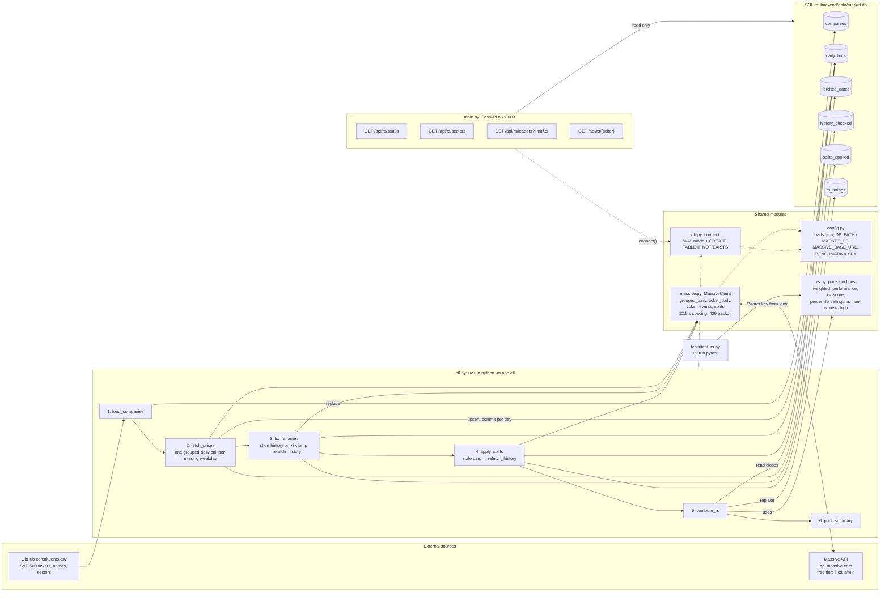
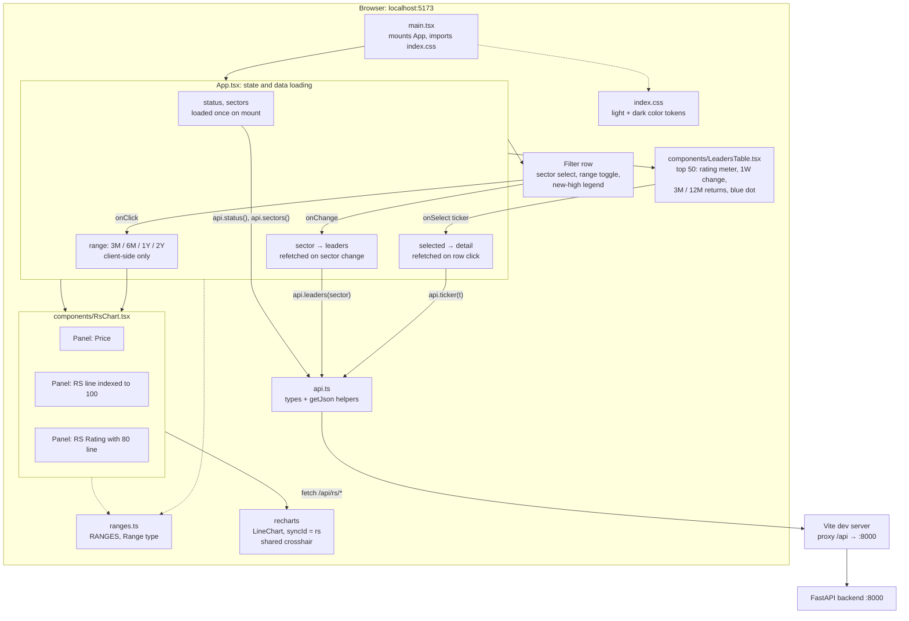

# Architecture

## Backend

The ETL (`app/etl.py`) fills SQLite from two external sources. FastAPI (`app/main.py`) only reads from SQLite and never calls Massive.

## Frontend

The browser only talks to Vite, and Vite proxies `/api` to FastAPI. Sector filtering happens on the server; the chart range is sliced in the browser.

